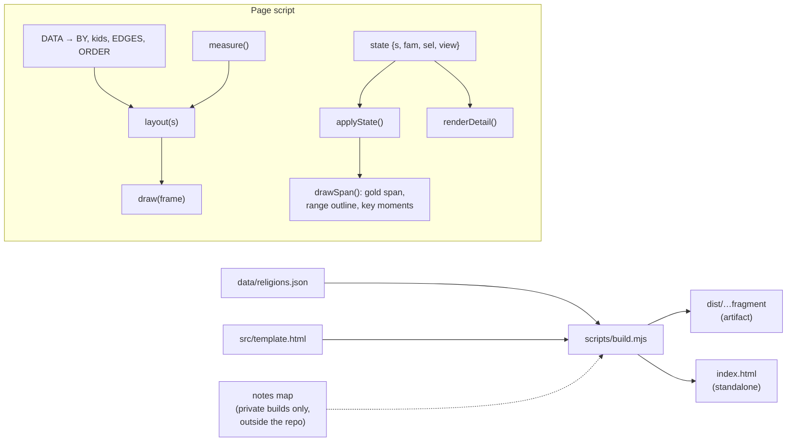

# Architecture

## Overview

| File | Role |
|---|---|
| `data/religions.json` | All content: 8 families, the world-today figures, and 44 religion records ([DATA-MODEL.md](DATA-MODEL.md)) |
| `src/template.html` | The page as an artifact fragment: `<title>`, font links, `<style>` with the design tokens, static markup, and one inline `<script>`. It holds two markers, `/*@DATA@*/null` and `/*@NOTES@*/null`. |
| `scripts/build.mjs` | Fills the markers and writes `dist/religions-through-time.html` (the fragment, for the claude.ai artifact) and `index.html` (a full document, for GitHub Pages and local use) |

See [ADR 0001](decisions/0001-single-self-contained-html-page.md) and [ADR 0012](decisions/0012-data-in-json-inlined-at-build.md).

## Page script

### Data

- `DATA` holds `families`, `world` and `religions`; it is injected at build time. If `DATA` is still `null` (the raw template), the page shows a "build the page" message and stops.
- `NOTES` is optional: a `{vault, files}` map for private builds ([ADR 0015](decisions/0015-private-notes-links-outside-the-repo.md)). It is always `null` in the public build.
- Derived at start-up:
	- `BY`: id → record.
	- `record.kids`: reverse lineage, as `[childId, kind]`.
	- `EDGES`: one `{from, to, kind}` per parent link.
	- `ORDER`: records in time order, with undated (`pre`) records first.
- Constants:
	- `Y0 = -3600`, `Y1 = 2030`: the dated axis.
	- `NOW = 2026`.
	- `R`: star radius per size class (`xl` 9, `l` 7, `m` 5.2, `s` 3.8, `none` 4.6).

### Geometry and scales

`geometry(s)` returns the horizontal frame for a scale blend `s` (0 = stretched, 1 = true to time):

| Value | Meaning |
|---|---|
| `W` | `max(scroller width, 1060)`. Below 1060 px the chart scrolls horizontally inside its container; the page body never scrolls sideways. |
| `ml`, `preW` | Left margin (18) and the undated block's width (`max(96, 8.5%)`) |
| `x0`, `mainW` | The dated axis. It starts 26 px after the undated block and ends 62 px before the right edge. |

`X(g, year)` blends `1 − √(Y1 − year)/√(Y1 − Y0)` (stretched) with `(year − Y0)/(Y1 − Y0)` (linear). `preX(g, i)` spaces the 5 undated slots. See [ADR 0004](decisions/0004-stretched-time-scale-and-undated-block.md).

### Layout

`layout(s)` returns a frame `{ g, pos: {id → {x, y, side, level, anchor, r}}, axisY, H }`:

1. **Side:** `up` when `how === "founded"`, otherwise `down` ([ADR 0003](decisions/0003-vertical-side-encodes-how-it-came-out.md)).
2. **Label box:** `label` over `ds`, measured on a canvas. The label sits right of the star, and flips left near the right edge.
3. **Level:** the lowest level on that side with no overlapping label box ([ADR 0011](decisions/0011-greedy-level-packing-for-labels.md)).
4. **Vertical metrics:**

	| Constant | Value | Meaning |
	|---|---|---|
	| `BAND` | 24 | Height of the time band |
	| `BASE` | 26 | Shortest stem |
	| `STEP` | 33 | Gap between levels |
	| `TOPPAD` | 34 | Room above the top level |
	| `BOTPAD` | 26 | Room below the bottom level |

	The height follows from the deepest level on each side.

### SVG layers (bottom to top)

| Layer | Contents |
|---|---|
| `defs` | `#rtt-glow` (Gaussian blur merged under the source), used through the `--glow` token |
| `gSky` | Seeded starfield (240 normalized points scaled to the frame), skipping the band. Its opacity comes from `--starfield`, so it is visible at Night and hidden by Day. |
| `gBands` | Alternating era bands and era names, each name hidden when it doesn't fit |
| `gAxis` | The time band, "UNDATED", and the axis-break mark |
| `gSpan` | The selected religion's gold span, plus a dotted `range` outline |
| `gTicks` | Year ticks (from a priority list, dropped when their labels would collide) and the "Today" marker |
| `gEdges` | One Bézier path per lineage link |
| `gMs` | Key-moment diamonds for the selected religion, on the band's top edge, with a 9 px hit circle and a tooltip |
| `gItems` | Per religion: stem, foot, halo, star (`.big` adds the glow), two-line label, and a hit rect |

### Interaction and state

`state = { s, fam, sel, view }`:

- **`s`**: the time scale, kept in `localStorage["rtt-scale"]`. Every storage access is wrapped in try/catch.
- **`fam`**: a family chip dims non-members to 18% and brightens lines inside the family.
- **`sel`**: the selected religion. It defaults to `christianity`, or to the URL hash if it matches an id.
	- It sets the gold star, halo pulse and stem.
	- Parents and children get halos.
	- Its lines turn gold.
	- It draws the span and key moments.
	- It highlights its world-today bar, if it has one.
	- It writes the hash with `history.replaceState`.
- **`view`**: `time` or `list`. They share the selection and the detail card.

Other behaviour:

- **Detail card** (`renderDetail()`):
	- story, key moments (hovering one highlights its diamond), and placement notes;
	- where it began, founders, beliefs, texts, branches, followers with their source;
	- lineage chips (they select that religion), eras, and sources;
	- a notes link when `NOTES` has this id.
- **World today** (`renderWorld()`): Pew shares as single-hue bars. A bar with an `id` is a button that selects that religion.
- **Sources and method:** fixed text, plus the follower sources grouped by identical source.
- **Search:** an `<input list>` with a `datalist` of names.
	- An exact match selects as you type.
	- Enter falls back to a prefix match, then a substring match.
	- A miss marks the field `aria-invalid`.
	- A family filter that would hide the match is cleared.
- **Tooltip:** shown on mouse hover and keyboard focus, never after a touch. It is clamped inside the chart shell.
- **Keyboard:**
	- stars are focusable buttons
	- Enter or Space selects
	- ← → step through time order
	- Escape hides the tooltip
- **Scale toggle:** a 650 ms ease-in-out tween between two frames. It jumps instead under `prefers-reduced-motion`, which also stops the halo pulse.
- **Resize and fonts:**
	- a `ResizeObserver` relayouts when the width changes by more than 4 px;
	- `document.fonts.ready` re-measures the labels.

## Theming

[ADR 0013](decisions/0013-night-and-day-themes.md):

- The page is dark-first. Night tokens sit on the bare `:root`.
- Day redefines the same tokens under `prefers-color-scheme: light` (when no theme is forced) and under `[data-theme="light"]`.
- The Night/Day buttons set `data-theme` and persist it in `localStorage["rtt-theme"]`. A `MutationObserver` keeps the buttons in sync if the host changes the attribute.
- No colour encodes a category ([ADR 0005](decisions/0005-focus-and-context-instead-of-family-colours.md)).

Fonts:
- Cormorant Garamond for display headings.
- IBM Plex Sans for the body.
- Plex Sans Condensed for chart labels.
- Plex Mono for dates.

## Runtime constraints (artifact contract)

- No skeleton tags in the template or the fragment; `<title>` comes first.
- External resources only from `fonts.googleapis.com` and `fonts.gstatic.com`.
- No `fetch`, no `alert`, `confirm` or `prompt`, and no `window.open`.
- Hashes are bare ids.
- `localStorage` is always wrapped.

## Toolchain

| Script | Does |
|---|---|
| `scripts/lib.mjs` | Paths, `readData()`, `readTemplate()`, `timeConstants()` (reads `Y0`, `Y1` and `NOW` from the template), `loadData()`, `inlineScript()` |
| `scripts/build.mjs` | `buildFragment({template, data, notes})`, `buildStandalone(fragment)`, `assertOutsideRepo(path)`; CLI with `--check` and private `--notes` builds |
| `scripts/validate.mjs` | The rules in [DATA-MODEL.md](DATA-MODEL.md) |
| `scripts/check-links.mjs` | GETs every Wikipedia, source, world and footer link; fails on anything but HTTP 200 |
| `tests/page.test.mjs` | 10 tests (below) |

The 10 tests check that:
- the data validates;
- there are 44 unique ids;
- both scripts compile;
- `index.html` is in sync with the source;
- the template and fragment keep the fragment contract;
- only CSP-safe hosts are used;
- the theme tokens are complete;
- the public build has no notes;
- private builds refuse in-repo paths;
- the validator catches broken lineage, cycles and unordered key moments.
