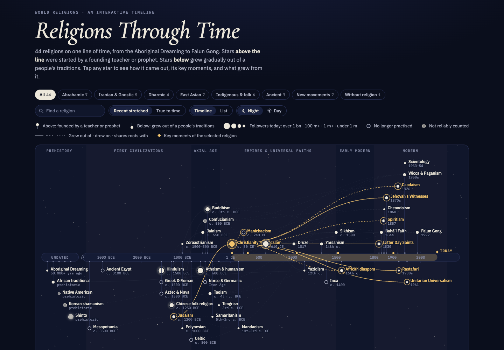
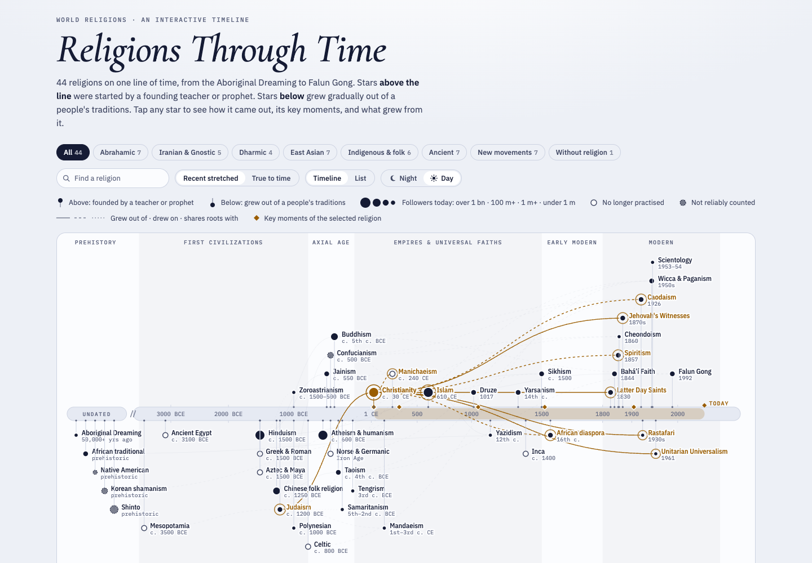

# Religions Through Time

An interactive timeline of 44 world religions, from the Aboriginal Dreaming to Falun Gong. It shows **when** each religion came out, **how** it came out (started by a founding teacher or prophet, or grown gradually out of a people's traditions), its **key moments**, and **which religions grew out of which**.

**Live site: [petrogko.com/religion-history-timeline](https://petrogko.com/religion-history-timeline/)**

It is a single, dependency-free HTML page: open `index.html` in any modern browser.



<details>
<summary>Day theme</summary>



</details>

## Reading the chart

| What you see | What it means |
|---|---|
| Star **above** the time band | Started by a founding teacher or prophet (the Buddha, Jesus, Muhammad, Guru Nanak, Joseph Smith…) |
| Star **below** the band | Grew gradually out of a people's traditions (Hinduism, Judaism, Shinto, the ancient religions…) |
| Star size | Followers today: over 1 billion · over 100 million · over 1 million · under 1 million |
| Hollow star | No longer practised (Ancient Egypt, Mesopotamia, the Norse gods…) |
| Dashed outline | Followers are not reliably counted |
| Solid / dashed / dotted line | Grew out of · drew on · shares roots with |
| Gold band on the axis | How long the selected religion has lasted, or did last; a dotted outline marks a debated or gradual start |
| Gold diamonds on the axis | The selected religion's key moments (hover for details) |
| "Undated" block on the left | Traditions older than any record, with no datable start |

Things you can do:

- **Tap or click a star** to open its card. The card covers:
	- how it came out, and its key moments;
	- where it began, its founder and key figures, core beliefs, sacred texts and main branches;
	- followers today, with the source of the figure;
	- what it came out of, and what came out of it;
	- its history in eras, and sources for further reading.
- **Find a religion** by name with the search box.
- **Filter by family**: Abrahamic, Iranian & Gnostic, Dharmic, East Asian, Indigenous & folk, Ancient, New movements, Without religion.
- **Switch the time scale.** "Recent stretched" gives the crowded last two centuries room; "True to time" gives every century the same width.
- **Switch between Night and Day.** The page follows your system setting until you choose.
- **Switch to List** for the same data as a table.
- **See the world today:** the share of the world's population by religion (Pew Research Center, 2020 data). Click a bar to open that religion.
- **Use the keyboard.** Tab to a star, use ← → to step through time, and press Enter to select.
- **Link to a religion** with its id as the URL hash, e.g. `index.html#sikhism`.

## Run it locally

No install is needed.

```sh
open index.html            # macOS; or double-click the file
npm run serve              # optional: http://localhost:8000 via Python's built-in server
```

The fonts load from Google Fonts. Offline, the page falls back to system fonts and still works.

## Project layout

```
data/religions.json        all content: families, world figures, 44 religion records
src/template.html          the page (HTML, CSS, JS) with markers where the build inlines the data
index.html                 generated standalone page; don't edit by hand
dist/                      generated artifact fragment (not committed)
scripts/build.mjs          data + template → dist/ and index.html  (npm run build / npm run check:build)
scripts/validate.mjs       structural checks on the data (npm run validate)
scripts/check-links.mjs    checks every external link returns HTTP 200 (npm run links)
scripts/lib.mjs            shared helpers
tests/page.test.mjs        node:test suite (npm test)
docs/                      README screenshots
AI/                        architecture, decisions (ADRs), data model, content guide, runbook
AGENTS.md, CLAUDE.md       entry points for AI coding agents
```

## Editing

1. Edit the content in `data/religions.json`; [AI/DATA-MODEL.md](AI/DATA-MODEL.md) documents every field. The page itself is `src/template.html`.
2. Run the checks and rebuild:

   ```sh
   npm run validate
   npm run build
   npm test
   ```

3. Follow [AI/CONTENT-GUIDE.md](AI/CONTENT-GUIDE.md) for tone, sourcing and placement. Common tasks are in [AI/RUNBOOK.md](AI/RUNBOOK.md).

Requires Node.js 20 or later. There are no npm dependencies.

## Publishing

- **GitHub Pages:** the site is deployed from `main` / root (Settings → Pages → *Deploy from a branch*). `index.html` is the site, and every push to `main` republishes it.
- **Claude artifact:** `npm run build` writes `dist/religions-through-time.html`, written to the claude.ai artifact page contract. See [AI/RUNBOOK.md](AI/RUNBOOK.md#republish-the-claude-artifact).

## About the content

The descriptions, key moments and eras are AI-assisted summaries of general historical knowledge, condensed from longer research histories. Key dates and figures were spot-checked in October 2026.

- **World shares** come from the [Pew Research Center (2025)](https://www.pewresearch.org/religion/2025/06/09/how-the-global-religious-landscape-changed-from-2010-to-2020/).
- **Follower figures** name their source where one exists: censuses, official reports, Pew.
- **Further reading:** every religion links to its Wikipedia articles, and every link is checked.

Many origin dates are approximate or debated, and follower counts for small or persecuted groups are rough estimates. The texts aim to be neutral: they separate what a tradition teaches from what historians conclude. Corrections are welcome; see [CONTRIBUTING.md](CONTRIBUTING.md).

## License

[MIT](LICENSE).
